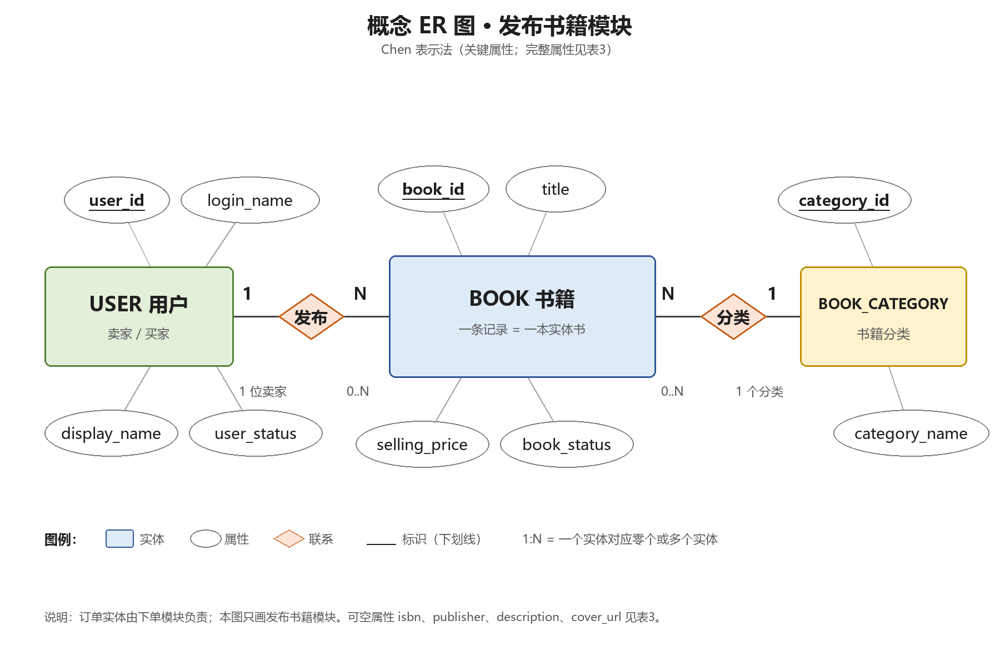
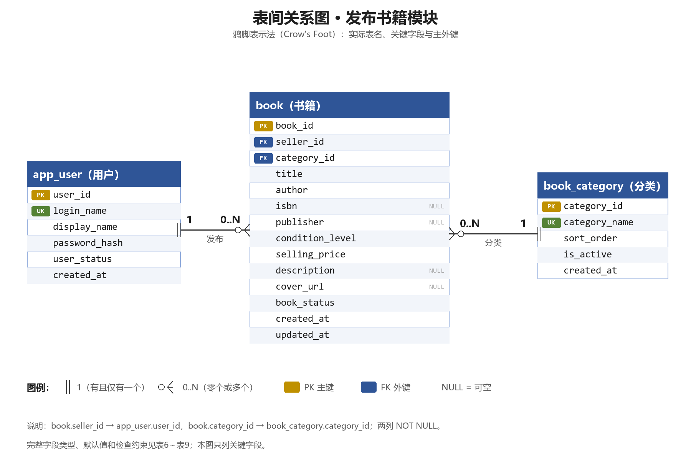

# 实验二 数据库设计材料（发布书籍模块）

> 课程：软件工程导论实验 · 实验二 数据库设计  
> 版本：v1.0 · 日期：2026-11-10  
> 主责：王伟锋（32406300079，软件243）  
> 范围：校园二手书交易平台 —— 发布书籍模块

---

## 1. 范围说明

本目录当前只包含本人主责的“发布书籍”模块数据库设计，覆盖三张表：

| 表名 | 用途 | 说明 |
|---|---|---|
| `app_user` | 用户/卖家账号 | 与下单模块共用；发布时提供 `seller_id` |
| `book_category` | 书籍分类字典 | 发布时选择分类；供检索按分类筛选 |
| `book` | 书籍发布记录 | 一条记录代表一本实体书 |

下单与取消模块使用的 `book_order` 表由组内该模块负责人设计，**不在本目录展开**。本模块通过 `book.book_id` 和 `book.book_status` 与其衔接。

本阶段不包含注册、找回密码、真实支付、退款、物流、交易完成、评价和推荐功能；选做 SQL 按小组要求忽略，未执行建表。

---

## 2. 文件清单

| 文件 | 内容 |
|---|---|
| [`design.md`](design.md) | 数据需求、概念 ER 图说明、逻辑设计、规范化、走查与修订记录 |
| [`data-dictionary.md`](data-dictionary.md) | 三张表的完整数据字典与约束汇总 |
| [`diagrams/concept-er.png`](diagrams/concept-er.png) | 概念 ER 图（Chen 表示法，关键属性） |
| [`diagrams/table-relationship.png`](diagrams/table-relationship.png) | 表间关系图（鸦脚表示法） |
| [`diagrams/draw_diagrams.py`](diagrams/draw_diagrams.py) | 两张图的生成脚本（Python 3.12 + Pillow 13） |
| [`../docs/reports/实验二/`](../docs/reports/实验二/) | 个人实验报告 |
| [`../records/ai-use.md`](../records/ai-use.md) | 大模型使用记录 |

个人报告：[`../docs/reports/实验二/32406300079_王伟锋_实验二.docx`](../docs/reports/实验二/32406300079_王伟锋_实验二.docx)

---

## 3. 表一览

### 3.1 `app_user`（用户表）

| 字段 | 含义 | 类型 | 约束 |
|---|---|---|---|
| `user_id` | 用户标识 | `BIGINT UNSIGNED` | PK，自增 |
| `login_name` | 登录名 | `VARCHAR(32)` | NOT NULL，UNIQUE |
| `display_name` | 显示名 | `VARCHAR(50)` | NOT NULL |
| `password_hash` | 口令散列 | `VARCHAR(100)` | NOT NULL；不存明文 |
| `user_status` | 账号状态 | `ENUM('ACTIVE','DISABLED')` | NOT NULL，默认 `ACTIVE` |
| `created_at` | 创建时间 | `DATETIME` | NOT NULL，默认当前时间 |

### 3.2 `book_category`（书籍分类表）

| 字段 | 含义 | 类型 | 约束 |
|---|---|---|---|
| `category_id` | 分类标识 | `TINYINT UNSIGNED` | PK，自增 |
| `category_name` | 分类名称 | `VARCHAR(30)` | NOT NULL，UNIQUE |
| `sort_order` | 显示顺序 | `SMALLINT UNSIGNED` | NOT NULL，默认 0 |
| `is_active` | 是否启用 | `TINYINT(1)` | NOT NULL，默认 1 |
| `created_at` | 创建时间 | `DATETIME` | NOT NULL，默认当前时间 |

### 3.3 `book`（书籍表）

| 字段 | 含义 | 类型 | 约束 |
|---|---|---|---|
| `book_id` | 书籍标识 | `BIGINT UNSIGNED` | PK，自增 |
| `seller_id` | 发布者 | `BIGINT UNSIGNED` | NOT NULL，FK → `app_user.user_id` |
| `category_id` | 分类 | `TINYINT UNSIGNED` | NOT NULL，FK → `book_category.category_id` |
| `title` | 书名 | `VARCHAR(120)` | NOT NULL，CHECK 去空格后非空 |
| `author` | 作者 | `VARCHAR(80)` | NOT NULL，CHECK 去空格后非空 |
| `isbn` | ISBN | `VARCHAR(20)` | NULL |
| `publisher` | 出版社 | `VARCHAR(100)` | NULL |
| `condition_level` | 成色 | `ENUM('NEW','LIKE_NEW','GOOD','FAIR')` | NOT NULL |
| `selling_price` | 售价（元） | `DECIMAL(8,2)` | NOT NULL，CHECK ≥ 0 |
| `description` | 描述 | `VARCHAR(500)` | NULL |
| `cover_url` | 封面地址 | `VARCHAR(255)` | NULL |
| `book_status` | 书籍状态 | `ENUM('ON_SALE','RESERVED')` | NOT NULL，默认 `ON_SALE` |
| `created_at` | 发布时间 | `DATETIME` | NOT NULL，默认当前时间 |
| `updated_at` | 更新时间 | `DATETIME` | NOT NULL，默认当前时间，更新时刷新 |

完整字段说明、默认值、约束名和删除/更新策略见 [`data-dictionary.md`](data-dictionary.md)。

---

## 4. 关键设计决定

1. **一条 `book` 记录 = 一本实体书**：不设 `quantity/stock`。同一卖家有多本同款书时，应建立多条 `book` 记录；不对 `(title, author)` 建唯一约束。
2. **代理键**：`book_id` 区分每一条发布记录；`(title, author)` 或 ISBN 都不能稳定唯一标识一本实体书。
3. **分类字典化**：分类名放在 `book_category`，`book` 只存 `category_id`，避免分类名重复存储和改名异常。
4. **价格规则**：`DECIMAL(8,2)`，`CHECK (selling_price >= 0)`；按小组当前约定，0 元表示赠送，不允许负数。
5. **状态范围**：`book_status` 只有 `ON_SALE`、`RESERVED`；不设 `SOLD`，因为交易完成不在系统范围内。取消订单后回到 `ON_SALE`。
6. **删除策略**：`book.seller_id`、`book.category_id` 均为 `NOT NULL`，删除/更新采用 `ON DELETE RESTRICT / ON UPDATE CASCADE`，避免历史书籍被级联删除。
7. **数据库约束与应用责任分开**：
   - 数据库能保证：主键、外键、唯一、枚举、`CHECK`、默认值；
   - 应用/事务负责：用户必须 `ACTIVE`、分类必须 `is_active = 1`、发布者身份校验、订单与 `book_status` 的同步更新。

---

## 5. 图表

### 5.1 概念 ER 图

图中只画关键/主要属性，完整属性见 [`data-dictionary.md`](data-dictionary.md)。订单实体由下单模块负责，不在本图展开。

### 5.2 表间关系图

`app_user 1:N book`（`book.seller_id`）；`book_category 1:N book`（`book.category_id`）。两列均为 `NOT NULL`。

---

## 6. 与订单模块的接口

本目录不定义 `book_order`，但发布模块与订单模块约定：

1. 订单模块通过 `book.book_id` 引用书籍；
2. 下单成功时将 `book.book_status` 从 `ON_SALE` 改为 `RESERVED`；
3. 取消成功时将 `book.book_status` 从 `RESERVED` 改回 `ON_SALE`；
4. 上述状态修改必须与订单写入/更新在同一事务中完成，并使用行锁或等价的并发控制；
5. `book_status` 只允许 `ON_SALE`、`RESERVED` 两个值。

订单表加入后，`book` 与 `book_order` 形成 1:N 引用（一本书可有多条历史订单，但同一时刻最多一条有效订单）；该约束由订单模块使用部分唯一索引、生成列唯一索引或事务锁落实。

---

## 7. 版本与变更

| 版本 | 日期 | 变更 | 作者 |
|---|---|---|---|
| v1.0 | 2026-11-10 | 完成发布书籍模块的数据需求、概念 ER 图、三张表设计、数据字典、表间关系图、规范化与走查 | 王伟锋 |

后续如小组统一调整字段、状态或约束，应在本表追加记录，并同步更新 `design.md`、`data-dictionary.md` 和个人报告。

---

## 8. 组内其他材料与命名差异

- 下单模块个人报告：[`../docs/reports/实验二/32406300083 许文博 软件243.docx`](<../docs/reports/实验二/32406300083 许文博 软件243.docx>)
- 下单模块建表 SQL：[`../sql/`](../sql/)

当前下单模块 SQL 使用 `user_account`、`book_listing`、`reservation_order`，本设计使用 `app_user`、`book_category`、`book`；状态值也存在 `AVAILABLE` 与 `ON_SALE` 的差异。两套材料均按各自负责人提交版本保留，正式合并建库前需组内统一表名、字段名和状态枚举，避免跨模块引用不一致。

## 9. 说明

- 图形由 Python 3.12 + Pillow 13 生成，源文件为 [`diagrams/draw_diagrams.py`](diagrams/draw_diagrams.py)；在 Windows 下运行 `py -3 draw_diagrams.py` 可重新生成两张 PNG。
- 本阶段未执行 SQL，走查结论为设计推演；实际建表后应使用虚构数据验证。
- 个人报告中的字段、约束、状态和本目录保持一致；报告是本目录设计的完整说明。
