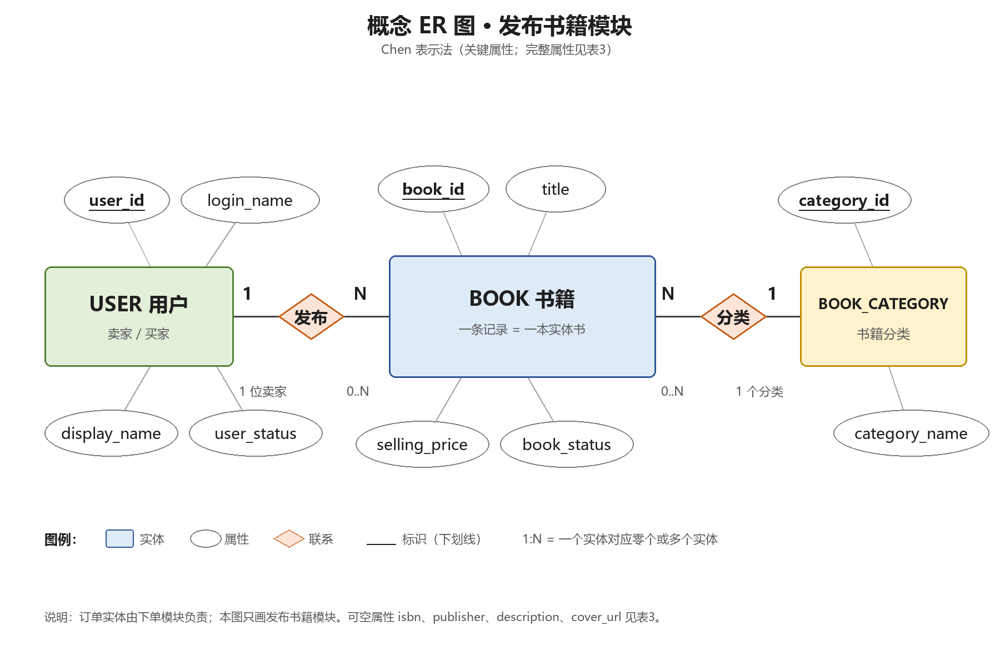

# 发布书籍模块数据库设计说明

> 版本：v1.0 · 2026-11-10  
> 主责：王伟锋（32406300079，软件243）  
> 对应个人报告：`../docs/reports/实验二/32406300079_王伟锋_实验二.docx`

---

## 1. 需求基线与设计范围

### 1.1 需求来源

- 本人实验一报告《广州大学学生实验报告（一）》（2026-11-03）；
- 小组 README 中确定的四项核心业务：发布书籍、检索与查看、下单预留、取消订单；
- 组员许文博实验一报告中关于发布字段的建议（用于字段完整性交叉核对）。

本报告不声称开展过未标明的访谈或调研。价格、字段长度等细节属于本设计提出的假设，需小组确认后固化。

### 1.2 范围

本人主责书籍管理模块中的“发布书籍”功能，因此本设计只展开：

- `app_user`：用户/卖家账号（与下单模块共用）；
- `book_category`：书籍分类字典；
- `book`：书籍发布记录。

`book_order` 由组内下单模块负责人设计，不在本设计展开。本模块通过 `book.book_id` 和 `book.book_status` 与订单模块衔接。

### 1.3 业务规则

| 编号 | 规则 |
|---|---|
| BR-01 | 一条 `book` 记录代表一本实体书，不设 `quantity/stock`；同一书名、同一作者可以有多条记录。 |
| BR-02 | 书名、作者、分类、成色、售价必填；描述、封面、ISBN、出版社可选。 |
| BR-03 | 售价为人民币，`DECIMAL(8,2)`，`>= 0`；0 元表示赠送。 |
| BR-04 | 发布成功后 `book_status` 初始为 `ON_SALE`；失败不产生记录。 |
| BR-05 | `seller_id` 必须引用存在的用户；用户是否 `ACTIVE` 由应用校验。 |
| BR-06 | `category_id` 必须引用存在的分类；分类是否启用由应用校验。 |
| BR-07 | 用户可同时承担买家和卖家角色，不另建卖家表；`seller_id` 表示本次发布者。 |
| BR-08 | 书籍被下单预留或取消时，`book_status` 由订单模块在同一事务中更新。 |
| BR-09 | 删除用户或分类时不得级联删除书籍；有引用时拒绝删除。 |
| BR-10 | 分类名称统一存放在 `book_category`，`book` 表只存 `category_id`。 |

---

## 2. 概念 ER 图



### 2.1 实体与标识

| 实体 | 标识 | 主要属性 | 说明 |
|---|---|---|---|
| 用户 USER | `user_id` | `login_name`（唯一）、`display_name`、`user_status` | 预置测试账号；同一用户可兼任买家和卖家 |
| 书籍 BOOK | `book_id` | `title`、`author`、`condition_level`、`selling_price`、`book_status`、`created_at`；可选 `isbn`、`publisher`、`description`、`cover_url` | 一条记录 = 一本实体书；不存数量 |
| 分类 BOOK_CATEGORY | `category_id` | `category_name`（唯一）、`sort_order`、`is_active` | 发布时选择；停用分类不再用于新发布 |

使用代理键 `book_id` 的原因：同一书名/作者可能对应多本实体书，ISBN 也可能缺失，`(title, author)` 或 ISBN 不能稳定唯一标识一条发布记录。

### 2.2 联系、基数与可选性

| 联系 | 参与实体 | 基数 | 可选性 | 实现 |
|---|---|---|---|---|
| 发布 | USER — BOOK | 1:N | 一个用户可发布 0..N 本书；一本书必须有且仅有一个发布者 | `book.seller_id` → `app_user.user_id` |
| 分类 | BOOK_CATEGORY — BOOK | 1:N | 一个分类可包含 0..N 本书；一本书必须有且仅有一个分类 | `book.category_id` → `book_category.category_id` |

`book.seller_id`、`book.category_id` 均为 `NOT NULL`，因此每本书必须有发布者和分类；用户和分类一侧的 0..N 表示允许暂时没有书籍。

---

## 3. 逻辑设计

### 3.1 关系模式

```text
app_user(user_id PK, login_name UK, display_name,
         password_hash, user_status, created_at)

book_category(category_id PK, category_name UK,
              sort_order, is_active, created_at)

book(book_id PK,
     seller_id FK -> app_user.user_id,
     category_id FK -> book_category.category_id,
     title, author, isbn, publisher,
     condition_level, selling_price, description,
     cover_url, book_status, created_at, updated_at)
```

转换规则：

1. 每个实体转换为一张表，实体标识作为主键；
2. 1:N 联系在 N 侧加入外键，不为“发布”联系单独建表；
3. 分类作为独立实体，`book` 保存 `category_id`，避免分类名重复存储；
4. 可空属性直接作为表的可空列。

### 3.2 表清单

| 表名 | 中文名 | 用途 | 主要关系 |
|---|---|---|---|
| `app_user` | 用户表 | 保存预置账号、显示名和账号状态；发布时作为卖家身份来源 | 被 `book.seller_id` 引用（1:N） |
| `book_category` | 书籍分类表 | 保存分类名称、排序和启用状态，供发布选择和检索筛选 | 被 `book.category_id` 引用（1:N） |
| `book` | 书籍表 | 保存发布书籍的字段、售价、品相、状态和归属 | 引用 `app_user`、`book_category` |

完整字段、类型、可空性、默认值和约束见 [`data-dictionary.md`](data-dictionary.md)。

### 3.3 主外键与约束

| 约束名 | 类型 | 涉及表/列 | 规则 |
|---|---|---|---|
| `pk_app_user` | 主键 | `app_user.user_id` | 唯一、非空 |
| `uk_app_user_login` | 唯一 | `app_user.login_name` | 唯一、非空 |
| `pk_book_category` | 主键 | `book_category.category_id` | 唯一、非空 |
| `uk_category_name` | 唯一 | `book_category.category_name` | 唯一、非空 |
| `pk_book` | 主键 | `book.book_id` | 唯一、非空 |
| `fk_book_seller` | 外键 | `book.seller_id` → `app_user.user_id` | `ON DELETE RESTRICT`、`ON UPDATE CASCADE` |
| `fk_book_category` | 外键 | `book.category_id` → `book_category.category_id` | `ON DELETE RESTRICT`、`ON UPDATE CASCADE` |
| `chk_book_price` | 检查 | `book.selling_price` | `>= 0` |
| `chk_book_title` | 检查 | `book.title` | `TRIM` 后长度 > 0 |
| `chk_book_author` | 检查 | `book.author` | `TRIM` 后长度 > 0 |

索引建议：

- `idx_book_seller_status(seller_id, book_status)`：卖家查看自己的在售书籍；
- `idx_book_category_status(category_id, book_status)`：按分类浏览可售书籍；
- `idx_book_created_at(created_at)`：按发布时间排序。

外键只保证引用存在，不保证被引用行处于可用状态。`seller` 必须 `ACTIVE`、`category` 必须 `is_active = 1`、`book` 必须 `ON_SALE` 才能被下单等规则，属于应用/事务责任。

---

## 4. 规范化

| 表 | 候选键 | 主要函数依赖 | 范式判断 | 说明 |
|---|---|---|---|---|
| `app_user` | `user_id`；`login_name` | `user_id →` 全部非主属性；`login_name → user_id、display_name` 等 | BCNF | 两个候选键，非主属性完全依赖候选键；无部分/传递依赖 |
| `book_category` | `category_id`；`category_name` | `category_id →` 全部；`category_name → category_id、sort_order、is_active` | BCNF | 分类名唯一；无非主属性间的传递依赖 |
| `book` | `book_id` | `book_id →` 全部非主属性 | BCNF | 单属性主键，不存在部分依赖；`category_name` 已移到分类表，避免传递依赖 |

说明：

1. `book` 使用单列代理主键 `book_id`，所有非主属性都完全依赖于 `book_id`，不存在对复合主键的部分依赖。
2. 分类名称只存放在 `book_category`，`book` 只保存 `category_id`。若把 `category_name` 同时存入 `book`，会出现 `category_id → category_name` 的传递依赖，并带来改名时的更新异常。
3. `book_status` 是受订单模块控制的状态列，不是由 `book` 表内其他列推导出来的；它和订单表之间的一致性由事务保证，属于受控冗余/状态缓存。保留该列可以避免发布/检索查询频繁跨模块连接，代价是订单模块必须在同一事务中同步更新。
4. `book` 表没有 `quantity/stock` 列，也没有多值属性；封面只保存一个 URL。若未来需要多张图片，应增加 `book_image` 子表，而不是在 `book` 中存逗号分隔的图片列表。

结论：三张表均达到 BCNF（至少 3NF）。

---

## 5. 走查场景

> 本次未执行 SQL，以下为设计推演；实际建表后应使用虚构数据验证。

| 编号 | 场景类型 | 给定数据 | 操作 | 预期变化 | 约束依据/责任层 |
|---|---|---|---|---|---|
| W-01 | 正常发布 | 用户 U01 为 ACTIVE；C01 为启用分类；书名/作者非空；成色 GOOD；售价 25.00 | 插入 `book(seller_id=U01, category_id=C01, ...)` | 新增 1 行；`book_status=ON_SALE`；`created_at/updated_at` 自动填充 | PK 自增；FK 存在；NOT NULL；CHECK >=0；DEFAULT |
| W-02 | 正常发布（可选字段为空） | 同上；`isbn`、`publisher`、`description`、`cover_url` 均为 NULL | 插入 `book` | 成功；可空列保持 NULL | 可空性定义 |
| W-03 | 异常：必填缺失 | `title` 为空字符串或 NULL | 插入 `book` | 拒绝；不产生记录；应用提示“书名为必填” | NOT NULL + CHECK(TRIM(title)<>'')；应用校验负责提示 |
| W-04 | 异常：价格为负 | `selling_price = -1.00` | 插入 `book` | 拒绝；不产生记录 | CHECK (`selling_price >= 0`) |
| W-05 | 边界：价格为 0 | `selling_price = 0.00` | 插入 `book` | 成功；表示赠送 | CHECK 允许 0；若小组改为必须 >0，需同步修改约束和表单提示 |
| W-06 | 边界：同书多本 | 同一 seller 连续发布两条 title/author 相同的记录 | 两次插入 `book` | 两条都成功；`book_id` 不同 | 不对 `(title, author)` 建唯一约束；一条记录=一本实体书 |
| W-07 | 异常：分类不存在 | `category_id = 999` | 插入 `book` | 拒绝；外键失败 | FK `book.category_id` |
| W-08 | 异常：卖家被禁用 | `user_status = DISABLED`；其余数据合法 | 插入 `book` | 数据库外键仍可通过；应用必须拒绝发布 | FK 只保证用户存在；ACTIVE 由应用校验 |
| W-09 | 边界：分类停用 | `category.is_active = 0`；历史书籍仍引用该分类 | 新发布选择该分类 | 应用拒绝新发布；历史书籍仍可查询 | FK 不检查 `is_active`；应用校验；分类不删除 |
| W-10 | 删除有书籍的卖家 | `app_user` 有 `book` 引用 | `DELETE app_user` | 拒绝删除 | `ON DELETE RESTRICT`；保留历史书籍 |

走查结论：

1. 数据库约束能保证：实体完整性（PK）、引用完整性（FK）、域完整性（ENUM、DECIMAL、CHECK）和默认值；不能保证跨表的“用户必须 ACTIVE”“分类必须启用”以及“发布者身份校验”等业务规则，这些必须由应用层在写入前检查。
2. 发布失败时，应用应在同一事务中完成校验和插入；若插入触发约束错误，应回滚并返回具体字段错误，不留下部分记录。
3. 本模块不修改 `book_status` 的后续值；订单模块需在同一事务中更新订单和书籍状态，避免“订单已取消但书籍仍预留”的不一致。

---

## 6. 自查修订记录

| 编号 | 发现 | 原设计 | 修订 | 依据/影响 |
|---|---|---|---|---|
| R-01 | 分类名重复存储 | 初稿在 `book` 中放 `category_name` 字符串 | 增加 `book_category` 字典表，`book` 只存 `category_id` | 消除传递依赖和改名异常；ER 图、数据字典、表间关系图同步修改 |
| R-02 | 误把同书多本当成重复发布 | 初稿考虑 `UNIQUE(title, author, seller_id)` | 取消该唯一约束，保留 `book_id` 区分实体书 | 需求规定一条记录=一本实体书；同一卖家可有多本同款 |
| R-03 | 状态范围过大 | 初稿设 `ON_SALE/RESERVED/SOLD` | 删除 `SOLD`，只保留 `ON_SALE/RESERVED` | 交易完成不在范围；取消后回 `ON_SALE` |
| R-04 | 库存字段与“一条记录一本”冲突 | 初稿设 `quantity` | 删除 `quantity`，需要多本时建多条记录 | 与实验一业务约定一致；避免库存扣减的额外事务 |

以上修订已反映在概念 ER 图、表间关系图和数据字典中。正式组间互评意见由小组共用记录另行保存；如互评提出字段或约束修改，应在本文件追加变更并更新个人报告版本。

---

## 7. 一致性检查

1. **实体与表**：USER→`app_user`、BOOK→`book`、BOOK_CATEGORY→`book_category`，三个实体各对应一张表，无多余联系表。
2. **联系与键**：发布 1:N → `book.seller_id`；分类 1:N → `book.category_id`；外键均落在 N 侧，符合转换规则。
3. **可选性与可空性**：书籍必须有 `seller_id`、`category_id` → 两列 NOT NULL；可选属性 → 可空列；用户/分类一侧的 0..N 不要求在表中存数组。
4. **命名一致**：ER 图、数据字典、表间关系图统一使用 `app_user`、`book_category`、`book` 及相同字段名。
5. **状态一致**：发布成功为 `ON_SALE`；下单预留为 `RESERVED`；取消后回 `ON_SALE`；不出现 `SOLD`。订单模块实现时必须沿用该枚举。

---

## 8. 工具与限制

- 图表：Python 3.12.5 + Pillow 13.0.0 绘制，源文件见 [`diagrams/draw_diagrams.py`](diagrams/draw_diagrams.py)。
- 排版：Microsoft Word 16.0。
- 数据库类型按 MySQL 8.0 语法书写；未执行 SQL，选做部分按小组要求忽略。
- 大模型使用：使用 DeepSeek（OpenCode 环境）辅助整理表结构初稿、检查约束表达和文字一致性；所有实体、主外键、业务约束由本人逐项核对。关键交互记录见个人报告 6.3 节。
